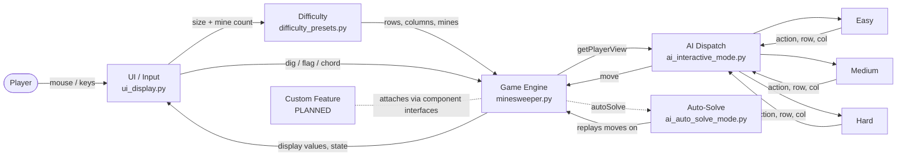

# System Architecture Overview

Describes the code as it stands on the `backend-tests` branch (commit `3177710`), which merges
`backend`, `ui_branch`, and `ai-medium-hard`. `main` does not yet have this code.

Legend: **[INHERITED]** = carried over from Project 1. **[BUILT]** = built for this project.
**[PLANNED]** = designed, not built; update after implementation.

## 1. Components

| Component | Responsibility | Status |
|-----------|----------------|--------|
| Game Engine | Owns board and game state; validates and applies moves; reports win/loss and a text status | [INHERITED] (extended: any board size, loss tracking, flag cap, player view, AI entry points) |
| UI / Input | Draws the board and status; converts mouse and keyboard input into engine operations; setup menu and end screen | [INHERITED] (extended: board-size tabs, game-mode and AI-skill menu, status line) |
| Difficulty | A `Difficulty` object holding rows, columns, and mine count; built at setup and held for the whole game | [BUILT] — `difficulty_presets.py` |
| AI Solver | Reads the player's view of the board and proposes one move per call at each skill level (Easy / Medium / Hard) | [BUILT] — `ai_solver_easy.py`, `ai_solver_medium.py`, `ai_solver_hard.py` |
| AI Dispatch | Routes to the solver matching the chosen skill level | [BUILT] — `ai_interactive_mode.py` |
| Auto-Solve | Lets the solver play the board out on its own, keeping the moves it played in a queue | [BUILT] — `ai_auto_solve_mode.py` |
| Turn Control | Decides whether the next move comes from the player or the solver | [BUILT] — folded into the UI loop (`MainGameplay(mode)`), not a separate component |
| Test Suite | Automated tests for the engine, the difficulty presets, and the three solvers | [BUILT] — `tests/`, 83 pytest cases |
| Custom Feature | Placeholder until the team selects the feature | [PLANNED] |

**Two separate things are both called "difficulty," so this document keeps them apart:**

- **Board difficulty** — grid size and mine count (a `Difficulty` object).
- **AI skill** — which solver plays, `aiLevel` 1–3 (Easy / Medium / Hard).

They are chosen independently at setup. A 20x20 board can be played with the Easy solver, and a
10x10 board with the Hard one.

## 2. Data Flow

**Setup:** the player picks a board size, a mine count, a game mode (player only / interactive /
auto-solve) and an AI skill level. The UI builds a `Difficulty` from the size and mine count and
passes it, with the AI level, to a new `Minesweeper`.

**Player path:** input → UI converts to a board position → Game Engine applies the operation →
UI reads display values and redraws.

**Solver path:** Game Engine builds the player's view (`getPlayerView()`) → AI Solver returns one
move as `(action, row, column)` → the engine applies it and the UI redraws.

**Game mode decides who moves:**

1. **Player only** — no solver runs.
2. **Interactive** — each move the player makes that changes the board gives the solver one turn.
3. **Auto-solve** — the solver keeps moving on a timer until the game ends.

The solver sees only what a player sees. It is handed `getPlayerView()`, never `_internal`, so
mine positions are never exposed.

## 3. System Diagram

Turn Control has no node of its own: it is the event loop in `MainGameplay(mode)`, which decides
per frame whether the player or the solver may act.

## 4. Key Data Structures

See `data_structures.md`. Summary: two parallel grids sized rows x columns (hidden truth,
player-visible state), a derived per-cell display code, a small set of counters held in one
engine instance, a `Difficulty` configuration object, and a linked-list `Queue` of auto-solve
moves.

## 5. Interfaces Between Components

- **UI → Engine:** `dig`, `flag`, `chord` by position; `clearAllFlags`, `revealAllMines`.
- **Engine → UI:** `display(row, col)` per cell, `mines` / `flags` / `remaining()` counts,
  `status()` bool, `state()` text.
- **Engine → Solver:** `getPlayerView()` only — a grid of display codes, no hidden state.
- **Setup → Difficulty:** rows, columns, and mine count; validated in `Difficulty.__init__`.
- **Difficulty → consumers:** read-only `rows`, `columns`, `mines`.
- **Solver → Engine:** one move as `(action, row, column)`, where action is `"dig"` or `"flag"`.
- **Engine → AI entry points:** `getAIMove()` for one move, `autoSolve()` for a whole run.
- Interfaces are the contract; internals of each component may change without invalidating this
  document.

## 6. Open Items

- [x] Difficulty: built as `difficulty_presets.Difficulty`, read by `Minesweeper.__init__`
- [x] AI Solver: three levels built; behaviors documented in `difficulty_selector_uml.md`
- [x] Turn Control: merged into the UI loop as planned
- [x] Diagram: placeholder nodes replaced with the built structure
- [ ] Custom Feature: not yet selected — component entry, diagram node, and data flow still to add
- [ ] Merge `backend-tests` into `main` so this document describes the default branch
- [ ] The setup menu still labels Medium and Hard "(soon)" and refuses to select them, even
      though both solvers are built and tested. Until that is changed, only Easy is reachable
      from the UI.
- [ ] The setup menu builds square boards only (`Difficulty(size, size, mines)`), so the
      rectangular `EXPERT` preset (16x30) is unreachable from the UI.
