# Difficulty Selector: UML Class Diagram

Describes the code on the `backend-tests` branch (commit `3177710`). Replaces the abstract
draft written before the selector existed.

The setup menu offers **two independent selections**, and both were loosely called "difficulty"
in the draft. They are separate here:

- **Board difficulty** — grid size and mine count, carried by a `Difficulty` object.
  **This is the team's custom feature.**
- **AI skill** — which solver plays, `aiLevel` 1-3 (Easy / Medium / Hard). Required by the
  assignment, not the custom feature.

```mermaid
classDiagram
    direction LR

    class UI["UI / Input · ui_display.py"] {
        BOARD_SIZES
        MODE_OPTIONS
        AI_OPTIONS
        DoSetup() tuple
        MainGameplay(mode)
    }
    class DF["Difficulty · CUSTOM FEATURE · difficulty_presets.py"] {
        +rows
        +columns
        +mines
        BEGINNER
        INTERMEDIATE
        EXPERT
    }
    class GE["Minesweeper · minesweeper.py"] {
        +rows
        +columns
        +mines
        +aiLevel
        getPlayerView()
        getAIMove()
        autoSolve()
    }
    class AD["AI Dispatch · ai_interactive_mode.py"] {
        getAiMoveInteractive(view, aiSkill, difficulty)
    }
    class AS["Auto-Solve · ai_auto_solve_mode.py"] {
        getMovesForAutoSolve(board, aiSkill, difficulty)
    }
    class E["Easy · ai_solver_easy.py"] {
        easy_mode(view, rows, columns)
    }
    class M["Medium · ai_solver_medium.py"] {
        medium_mode(view, rows, columns)
        find_basic_move(view, rows, columns)
    }
    class H["Hard · ai_solver_hard.py"] {
        hard_mode(view, rows, columns)
        find_121_move(view, rows, columns)
    }

    note for UI "DoSetup() returns (size, mines, mode, aiLevel)"
    note for DF "The team's custom feature. ValueError unless 1 <= mines < rows * columns"

    UI --> DF : builds one per game
    DF --> GE : rows, columns, mines
    UI --> GE : dig / flag / chord
    GE ..> UI : display codes, state()
    GE --> AD : player view + aiLevel
    GE --> AS : board + aiLevel
    AS --> AD : asks for one move at a time
    AD --> E : aiLevel 1
    AD --> M : aiLevel 2
    AD --> H : aiLevel 3
    M ..> E : random fallback
    H ..> M : basic rules
    H ..> E : random fallback
```

## What each AI skill level does

| Level | Name | Behavior |
|-------|------|----------|
| 1 | Easy | Digs a random covered, unflagged cell. |
| 2 | Medium | Applies neighbor-count rules — flags a cell when every remaining hidden neighbor must be a mine, digs when all adjacent mines are already flagged. Falls back to Easy's random dig. |
| 3 | Hard | Medium's rules first, then horizontal and vertical 1-2-1 patterns. Falls back to Easy's random dig. |

Every level returns one move per call as `(action, row, column)`, where action is `"dig"` or
`"flag"`, or `None` when no legal move is left.

## Game modes

Mode is chosen alongside the two difficulty selections and decides who moves, not how well.

| Mode | Behavior |
|------|----------|
| `player` | No solver runs; AI skill is ignored. |
| `interactive` | Each player move that changes the board gives the solver one turn. |
| `auto` | The solver keeps moving on a 600 ms timer until the game ends. |

## Legend

- Solid arrow: the source uses or drives the target. Dotted arrow: the source only reads from
  the target, or uses it as a fallback.
- Names match `architecture_overview.md`.

## Known gaps between this design and the running menu

- `AI_OPTIONS` still labels Medium and Hard "(soon)", and the click handler only accepts
  `value == 1`, so Easy is the only level selectable from the UI even though all three solvers
  are built and covered by tests.
- `DoSetup()` builds `Difficulty(size, size, mines)`, so only square boards are reachable from
  the UI and the rectangular `EXPERT` preset (16x30) cannot be selected.
- There is no separate "Game Configuration" class, as the draft anticipated. The four setup
  choices are held as a plain `settings` tuple in `ui_display.py` and unpacked at game start.
